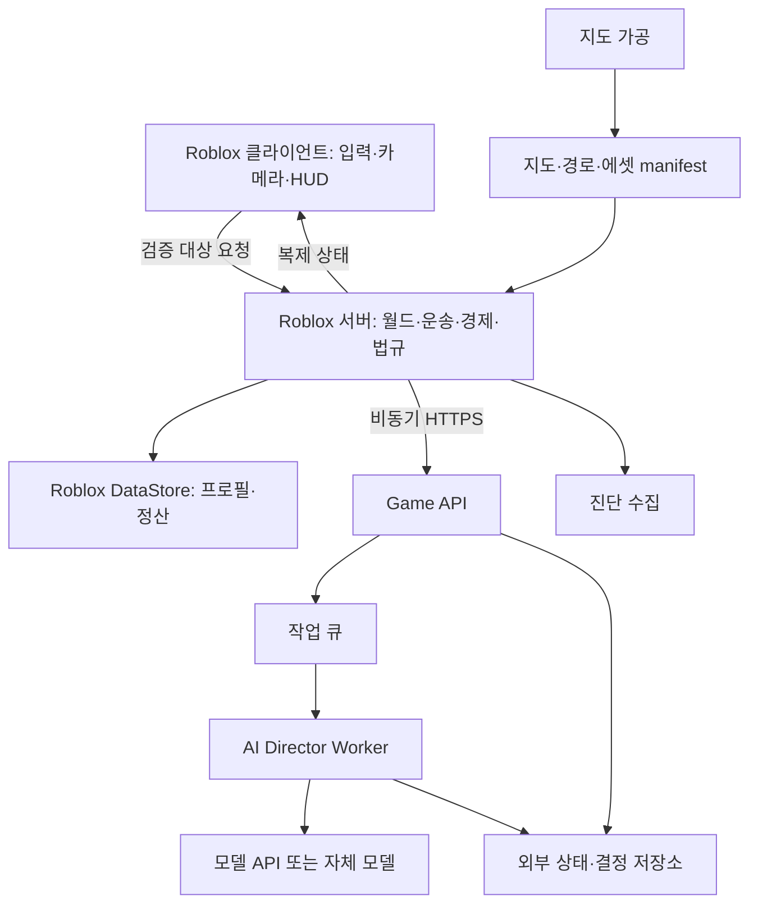

# 프로젝트 아키텍처

작성일: 2026-10-08 · 목표 설계, 구현 전

## 1. 시스템 경계

현재 Rojo는 `src/client`, `src/server`, `src/shared`를 각각 StarterPlayerScripts, ServerScriptService,
ReplicatedStorage에 연결한다. 이 매핑을 유지한다. MSA는 외부 비실시간 서비스에 적용하고
Roblox 내부 모듈은 동일 프로세스의 도메인으로 운영한다.



## 2. 목표 코드 구조

`예정` 항목은 아직 존재하거나 실행된다고 가정하지 않는다.

```text
taximulation/
├── README.md / default.project.json / aftman.toml
├── src/
│   ├── client/
│   │   ├── init.client.luau
│   │   ├── controllers/       # 예정: Input, Camera, Vehicle, HUD
│   │   └── views/             # 예정: Dispatch, Passenger, Garage
│   ├── server/
│   │   ├── init.server.luau
│   │   ├── domains/           # 예정: Ride, Dispatch, Wallet, Law
│   │   ├── simulation/        # 예정: Traffic, Citizens, Police, Interest
│   │   ├── adapters/          # 예정: DataStore, HTTP, Marketplace
│   │   └── bootstrap/         # 예정: 접속·설정·종료
│   └── shared/
│       ├── contracts/         # 예정: DTO, Remote, 버전
│       ├── config/            # 예정: 공개 가능한 밸런스
│       └── math/              # 예정: 좌표·그래프·순수 계산
├── services/                 # 예정: TypeScript 외부 서비스
│   ├── game-api/
│   ├── director-worker/
│   └── telemetry-worker/
├── packages/contracts/       # 예정: JSON Schema, 예제·코드 생성
├── world/                    # 예정: 출처·가공 설정·manifest
├── tools/                    # 예정: 지도 변환·하네스
├── tests/                    # 예정: 단위·상태기계·계약
├── harness/                  # 예정: fixtures, scenarios, faults, evals
├── infra/                    # 예정: compose·Terraform
├── docs/                     # 이번 작업 산출물
└── artifacts/                # 예정: 재현·로그·프로파일 증거
```

외부 서비스는 TypeScript/Fastify, 영속 저장은 PostgreSQL, 지도 가공은 Python을 초기 제안으로 둔다.
실제 버전과 의존성은 P0에서 호환성 검증 후 고정한다.

## 3. 의존 방향·권한

클라이언트는 shared 계약에 의존한다. 서버 도메인은 HTTP/DataStore/모델 API를 직접 호출하지 않는다.
Clock, Random, ProfileRepository, DirectorPort, PaymentPort를 주입해 가짜 환경에서 같은 규칙을 실행한다.
shared에는 비밀·관리 권한·비공개 탐지 설정을 넣지 않는다.

| 결정 | 최종 권한 | 클라이언트 역할 |
|---|---|---|
| 카메라·조작 의도 | 클라이언트 | 요청·화면 예측 |
| 차량 물리 | Roblox 물리 + 서버 검증 | 필요 시 물리 소유권, 결과 무조건 신뢰 금지 |
| 배차·좌석·운송 | Roblox 서버 | 수락·승하차 요청 |
| 돈·구매·면허 | 서버·영속 프로필 | 읽기 표시 |
| NPC 목표·경찰 출동 | 서버 규칙 | 직접 변경 불가 |
| AI 결정 | 서버 검증 후 효력 | 실행 코드 수신 금지 |
| 지도 버전 | 빌드 manifest | 자의적 교체 불가 |

Remote는 타입·범위·빈도·소유권·거리·상태를 검증한다.
클라이언트 좌표 한 번으로 운송 완료·과속·체포를 판정하지 않고 서버 관측 이력과 허용 오차를 사용한다.
순간 통신 이상만으로 영구 제재하지 않는다.

## 4. 지도·경로·LOD

1. 데이터셋 출처·버전·영역·좌표계·라이선스·재배포 권한·가공 이력을 기록한다.
2. 투영 좌표 → 공통 원점 → `studsPerMeter` 변환을 지형·도로·건물·시설물에 동일 적용한다.
3. 차선 방향, 회전, 교량/터널 층과 높이, 속도, 승하차 지점을 경로망으로 만든다.
4. 시각적으로 교차하는 고가/지상도로를 연결하지 않는다. 차량 경로와 내비게이션은 같은 토폴로지를 사용한다.
5. 구역별 에셋을 가공하고 manifest에 버전·해시·출처를 기록한다.
6. 경로망은 시각 스트리밍과 분리해 보이지 않는 목적지도 탐색할 수 있게 한다.

외형은 Roblox LOD/SLIM·StreamingEnabled를 검증 후 적용한다.
서버 NPC 계산량은 별도 InterestManager가 관리한다. 스트리밍만으로 서버 CPU 절약을 보장하지 않는다.
전방 준비 거리는 `속도 × 실측 로딩 지연 상위값 + 회전·제동 여유`로 시작한다.
로딩 실패 시 위험 구역 전 감속·안전 대기를 제공한다. 최고 속도·급유턴·저속 네트워크로 검증한다.
수십 ㎢ 규모의 좌표·물리 안정성을 실측하고 구역/place 분리는 그 결과로 판단한다.

## 5. 시뮬레이션 계층

| 계층 | 책임 | 주기 |
|---|---|---|
| 주변 물리·회피 | 충돌·차간 거리·신호 반응 | 프레임 예산 내 실시간 |
| 경로·상태 | 걷기·운전·예약·수색 | 분산 스케줄·변화 시 재계산 |
| 지역 상태 | 교통량·수요·사건 슬롯 | 저빈도 규칙 |
| AI 감독 | 목표·사건 제안 | 초기 15–30초, 예산에 따라 조정 |

관심 영역은 모든 플레이어와 중요 객체의 합집합이다. 탑승·대화·예약·추격 객체는 보존한다.
생성은 차선/보행망·비가시 조건을 검증하며 교착 감지·회복을 둔다.
물리 자체의 완전 결정성을 가정하지 않는다. 재현 하네스는 논리 상태와 이벤트 결과를 검증한다.

## 6. AI 경계

사건 요약·허용 대상 ID만 입력하고 채팅·실명·개인 이력을 기본 전송하지 않는다.
경찰에게는 목격/신고 기반 관측만 전달한다. AI 응답은 action JSON이며 임의 코드·URL·도구 호출을 허용하지 않는다.
스키마·만료·worldRevision·대상 존재·사건 근거·예산·쿨다운을 검증한다.
기존 NPC 목표를 유지한 채 비동기로 처리하며 늦거나 종료된 사건의 제안은 폐기한다.

## 7. 설계 결정

| ADR | 결정 | 근거 |
|---|---|---|
| A01 | 실시간 도메인은 Roblox 내부 | 외부 왕복으로 주행·정산이 지연되지 않음 |
| A02 | 경제 영속 상태는 DataStore 단일 소유 | 외부 DB와 잔액 이중 쓰기 방지 |
| A03 | 외부는 API·감독·수집부터 분리 | 부하·실패 경계가 다른 서비스 우선 |
| A04 | AI는 제안, 규칙 대체 필수 | 모델 장애·비용이 게임 진행을 막지 않음 |
| A05 | 지도 사전 가공·버전 고정 | 실행 중 권리 불명 타일 추출 금지 |
| A06 | 서버별 독립 도시 | 전역 실시간 추격·공유 도시 범위 제외 |
| A07 | 광고와 면허 회복 분리 | 진행 관문 금지·무료 복구 보장 |

계약은 [서비스 명세](SERVICES.md), 운영은 [배포](DEPLOYMENT.md), 검증은 [하네스](HARNESS_ENGINEERING.md)를 따른다.
