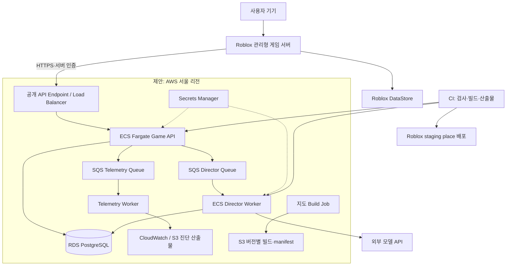

# 배포 구조 및 운영 계획

작성일: 2026-10-08 · 인프라 제안 · 실제 리소스 생성·배포 없음

## 1. 실행 위치

Roblox 클라이언트와 게임 서버는 Roblox가 운영한다. 자체 클라우드에 Roblox 게임 서버 컨테이너를 띄우는 구조가 아니다.
자체 클라우드는 AI API·worker·관측·지도 빌드만 실행한다. 외부 LLM API를 쓰면 초기 GPU 서버가 필요 없다.
자체 모델 GPU 호스팅은 비용·지연·운영 인력이 검증된 뒤 선택한다.

AWS 서울은 제안안이며 계정·비용·지연을 확인한 확정 결정이 아니다.
Roblox 게임 서버의 물리 위치를 서울로 보장할 수 있다고 가정하지 않는다. 실제 왕복 지연을 측정해 리전을 결정한다.
Kubernetes는 초기 필수 구성에 넣지 않는다. 부하 특성이 다른 API와 worker는 별도로 확장한다.

## 2. 환경 분리

| 환경 | Roblox | 외부 서비스 | 데이터 |
|---|---|---|---|
| local | Studio 테스트 place | loopback API·가짜 모델·DB/큐 어댑터 | 합성 fixture, 광고 mock |
| staging | 별도 비공개 테스트 experience | 전용 서비스·비밀·DB schema/가능하면 별도 DB | 합성 계정, 최소 비용 모델 |
| production | 공개 experience | 운영 서비스·보호된 비밀·별도 DB | 운영 데이터 |

Studio localhost 접근 가능 여부는 도구·보안 설정에 따라 검증한다.
게시된 Roblox 서버는 개발자 PC의 localhost에 접근하지 못하므로 staging은 유효 TLS의 공개 HTTPS 주소가 필요하다.
게임 자격과 광고 검증은 실제 플랫폼 환경에서 수행하며 로컬 mock 성공을 광고 승인으로 취급하지 않는다.
staging과 production은 Universe·DataStore·비밀·상품 식별자를 분리한다. Studio에서 운영 저장소에 쓰지 않는다.

## 3. 네트워크·인증·비밀

- API endpoint만 외부에 노출한다. DB와 worker는 private subnet, DB 접근은 서비스 보안 그룹으로 제한한다.
- worker의 모델 API 통신에는 명시적 외부 통신 경로가 필요하다. NAT 비용과 모델 데이터 전송 지역도 산정한다.
- Roblox 고정 출발 IP allowlist를 가정하지 않고 환경별 secret 인증과 세션 범위 토큰을 사용한다.
- bootstrap 키는 Roblox Secrets에 저장하고 외부에는 Secrets Manager로 주입한다.
- API는 요청 크기·빈도·세션 범위·멱등키를 검증한다. 키 교체는 구/신 키의 짧은 병행 기간으로 진행한다.
- CI는 가능하면 OIDC와 최소 권한 cloud role을 사용한다. Roblox 발행 키는 별도 최소 권한 비밀로 둔다.
- 원문 채팅과 비밀을 로그에 남기지 않는다. 기록은 가명 ID, 사건 종류, 버전, 판정 이유 위주다.

## 4. 로컬 개발 구성 목표

P0에서 `infra/compose.yaml`, API/worker Dockerfile, 가짜 모델과 큐 어댑터를 구현한다.
로컬 큐는 실제 SQS의 at-least-once·재시도·중복 특성을 재현해야 하고 단순 메모리 큐 성공만으로 운영 검증을 대체하지 않는다.
오프라인 하네스는 클라우드 계정·모델 API 키 없이 돌아가게 한다.
현재 실행 가능한 것은 README의 Rojo build/serve뿐이다. compose·Terraform·CI 파일은 이번 문서 작업에 포함되지 않았다.

## 5. CI/CD 목표 흐름

1. PR: 변경 경로별 형식·타입·순수 규칙·계약·재현 시나리오 검사.
2. 공통 계약이 바뀌면 Luau·TypeScript 양쪽 호환성 및 이전 버전 fixture 검사.
3. Rojo place·외부 이미지·지도 manifest를 commit SHA와 해시로 빌드해 불변 산출물로 보관.
4. 외부 DB는 먼저 호환 가능한 추가 변경 적용; API는 현재/직전 게임 계약 지원.
5. staging에 외부 API/worker와 테스트 place를 배포하고 합성 시나리오 실행.
6. Studio/실기기에서 운전·스트리밍·멀티클라이언트 결과를 첨부. 물리·광고 검사를 headless 성공으로 대체하지 않음.
7. 모든 gate를 통과한 동일 산출물을 production에 승격. 실제 배포 작업의 권한·비용 범위를 해당 작업에서 확정.
8. 기능 flag로 AI·쟁탈·수익화를 각각 작은 범위부터 활성화하고 오류·비용·게임 지표 확인.

Rojo 산출물과 mesh 등 업로드 에셋 ID를 함께 manifest에 기록한다. place 파일만 되돌려도 에셋이 일치해야 한다.
Roblox 발행은 Studio 또는 검증된 Open Cloud 경로를 사용한다. CI 자격·API 지원은 P0/P8에서 실제 확인한다.
새 place 발행이 기존 실행 서버를 즉시 교체한다고 가정하지 않는다. 구버전 서버가 종료될 때까지 계약을 유지한다.
신규 세션 유도/정상 종료 정책은 진행 중 운송의 중립 취소·영속 정산 복구를 포함해야 한다.

## 6. 배포 manifest

| 필드 | 의미 |
|---|---|
| buildId / commitSha | 재현할 소스·빌드 |
| placeArtifactHash / assetManifestHash | Roblox place와 에셋 목록 |
| apiImageDigest / workerImageDigest | 외부 실행 이미지 |
| contractVersion / profileSchemaVersion | 호환성·저장 형식 |
| mapVersion / licenseManifestVersion | 지도와 권리 자료 |
| configVersion / promptVersion / modelVersion | 게임 규칙과 AI 비교 기준 |
| testRunIds / approvalEvidence | staging·기기·정책 검증 증거 |

## 7. 장애와 롤백

| 장애 | 즉시 대응 | 복구 검증 |
|---|---|---|
| 모델 지연/오류/비용 초과 | AI flag off, 규칙 감독 유지 | pending AI 만료, 주행·운송 정상 |
| 외부 API/DB/큐 장애 | bounded retry·circuit breaker | 기본 게임 진행, 복구 시 오래된 명령 폐기 |
| DataStore 장애 | 새 금전 거래 제한, 진행 거래 pending 유지 | 재접속/lease 복구, 중복 지급 0 |
| 잘못된 게임 배포 | 신규 기능 차단, 검증된 place·asset 버전으로 발행 | 기존 세션 처리와 구/신 계약 병행 |
| 지도 손상 | 해당 구역 신규 진입 제한, 마지막 정상 manifest | 고아 승객·차량 안전 복구 |
| 분석 수집 장애 | 제한 buffer 후 drop, drop 수 기록 | 게임 무중단, 관측 누락 표시 |

DB 스키마는 역호환 변경을 먼저 하고 제거는 구버전 종료 이후 한다.
경제 데이터를 과거 백업으로 단순 덮어써 지급을 되돌리지 않는다. 복원은 거래 저널 대조·보상 거래로 수행한다.
외부 DB는 자동 백업/PITR, 산출물은 버전 보관을 제안한다. Roblox 저장 버전·복구 절차는 별도 드릴로 검증한다.
RTO/RPO는 P0에서 초안을 정하고 운영 부하·예산 측정 후 출시 gate에 명시한다. 현재 보장 수치는 없다.

## 8. 운영 지표와 비용

- 실시간: client frame time, server simulation time, 활성 NPC/차량, 스트리밍 지연·메모리.
- 경제: 미완료 정산 수·나이, 중복 차단, 프로필 잠금 충돌, 저장 실패.
- AI: queue age, p50/p95 지연, timeout·fallback, action 거절, 입력/출력 토큰·비용.
- 경험: 첫 운송 완료 시간, 운송 취소 원인, 기사/손님 비율, 추격 후 이탈, 교육 복귀 성공.

AI 시간당 판단 수 ≈ 활성 Roblox 서버 수 × 3600 / 판단 주기(초).
15초 주기면 서버당 시간당 240회이며 NPC 대화는 별도다. 단가는 모델과 토큰 측정 전 추정하지 않는다.
월 비용은 모델 + API/worker + DB/큐 + 로드밸런서/NAT + 로그·저장·전송을 합산한다.
예산 상한 초과 시 AI를 중단해도 NPC 운송·교통·경찰은 계속 작동해야 한다.
