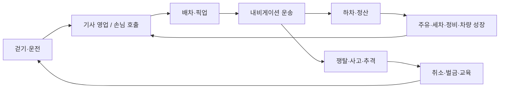
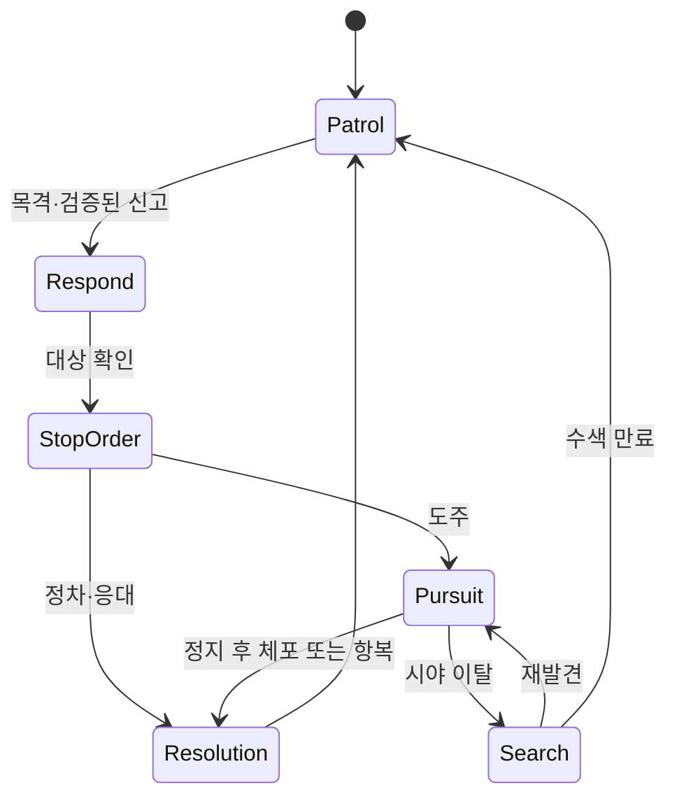

# 게임 기능 및 규칙

작성일: 2026-10-08 · 제품 기준선 제안 · 구현 전

## 1. 목표와 규모

서울에서 택시 기사 생활을 하며 성장하고 시민·다른 기사·경찰과 사건을 만드는 오픈월드.
실제 도로 연결과 도시 배치를 활용하되 주행과 상호작용을 위해 가공한다.
최종 지도는 여러 도심을 연결한 수십 ㎢를 목표로 한다. 첫 검증 구역 1~2㎢는 최종 크기 제한이 아니다.
서버당 24명은 초기 부하 시험 목표다. 모바일·교통량·넓은 지도 동시 지원 여부는 실측한다.

## 2. 기능 목록

| ID | 기능 | 명세 | 도입 단계 |
|---|---|---|---|
| F01 | 도보·운전 | 걷기, 승하차, PC·모바일 조작 | P1 |
| F02 | 카메라·HUD | 운전석/추적 시점, 속도·연료, 미니맵·회전 안내 | P1–P2 |
| F03 | 서울 맵 | 도로·지형·건물, LOD·스트리밍, 승하차 지점 | P2 |
| F04 | 시민 | 보행·횡단·상점 방문·대기·대화 | P3 |
| F05 | 교통 | 승용차·SUV·NPC 택시·버스·경찰차; 이후 배송·오토바이·긴급차 | P3/P5 |
| F06 | 역할 | 기사/손님 전환; 운송 정산 전 변경 제한 | P3–P4 |
| F07 | 콜·배차 | 콜 카드, 수락, 기사 한 명 예약, 영업 중단 | P3 |
| F08 | NPC 운송 | NPC 콜·길거리 승객, 픽업·운송·정산 | P3 |
| F09 | 유저 운송 | 호출, 기사 선택/자동 배차, 예치·취소·환불 | P4 |
| F10 | 내비게이션 | 일방통행·교량·터널 경로, 재탐색 | P2–P3 |
| F11 | 경제·성장 | 수입, 경력·평판, 기본/우수/프리미엄/대형 택시 | P3/P5 |
| F12 | 차량 생활 | 주유·세차·수리·차고지·꾸미기·견인 | P5 |
| F13 | 법규·면허 | 단속·벌금·벌점·교육·영업 면허 정지와 회복 | P5 |
| F14 | 경찰 | 목격·신고·정차 명령·추격·수색·체포·도주 | P5 |
| F15 | 쟁탈 | 손님 경쟁, 밀치기·던지기, 시민·차량 충돌, 책임·보험 | P6 |
| F16 | AI 도시 | 행동에 따른 수요·사건·순찰 제안, 주요 NPC 기억 | P7 |
| F17 | 수익화 | 꾸미기·차고 슬롯·선택형 광고·구매 복구 | P8 |

단계 정의와 작업 의존성은 [작업 계획](WORK_PLAN.md)에 있다.

## 3. 역할·수요·운송

- 기사는 영업 시작 → 콜 선택 → 픽업 → 운송 → 정산한다. 탑승객/추격/면허 정지 중 신규 일반 콜은 막는다.
- 손님은 승차 지점·목적지·견적을 확인한 뒤 자동 배차 또는 기사 선택을 사용한다.
- 사람 손님과 NPC 손님을 구분해 표시한다. 사람 수와 별개로 NPC 콜을 공급하되 활동 기사와 지역 수요에 따라 상한을 둔다.
- NPC 택시는 플레이어 우선 배차 시간이 지난 수요를 수행하고 유저 기사가 없으면 유저 손님도 태운다.
- 보행 시민 일부가 목적에 따라 택시를 호출한다. 모든 시민이 택시 제안을 수락하지 않는다.
- 손님 역할에는 탐방·첫 방문·목적지 미션을 제공한다. 탑승 시간만으로 돈을 생성하지 않는다.
- 운송 도중 역할 전환은 금지하며 취소 정산 후 가능하다.

콜 카드는 화면 오른쪽 위 최대 3개를 시작값으로 한다. 픽업 거리, 목적지 지역, 예상 운임, 승객 수, 등급을 표시한다.
왼쪽 아래는 경로, 아래 중앙은 속도·연료, 상단은 필요한 순간의 단속·추격 안내에 사용한다.
같은 콜은 여러 기사에게 제안할 수 있지만 서버에서 한 명에게만 예약한다.
승차·하차는 거리·정차·좌석·예약 소유권을 확인한다. 목적지에는 실제 정차 가능한 지점을 연결한다.
접속 종료·거절·예약 만료는 정상 상태 전이로 다룬다.

## 4. 시민·교통·대화

시민 기본 상태는 `Walking → Waiting → RequestingRide → Boarding → Riding → Leaving`이다.
`Fleeing / Reporting / Ragdoll / Recovering` 반응은 기본 행동을 중단하지만 예약·좌석 상태와 일관돼야 한다.
대화 선택지는 택시 제안, 목적지 질문, 도움 요청, 사과부터 시작한다.
성격은 급함/신중함/관광 등 설정값으로 구현하며 LLM 자유 대화는 후속 정책 검증 뒤 도입한다.

차량은 목적지, 차선 경로, 차간 거리, 신호 대기, 회전·합류 상태를 가진다.
버스는 노선·정류장, 배송차는 배송 정차, 경찰차는 순찰·추격 목표를 사용한다.
긴급차 양보와 사고 견인으로 도로 교착을 해소한다. 오토바이·구급차·소방차는 기반 교통이 안정된 뒤 확장한다.
플레이어 주변은 정밀 시뮬레이션, 먼 지역은 교통량·수요 요약으로 처리한다.
생성/제거 시 모든 플레이어의 가시 범위를 고려하고 예약·탑승·대화·추격 객체는 유지한다.

## 5. 경제·차량 성장

운임 = 기본 요금 + 정상 경로 거리 요금 + 상한 있는 시간 요금 + 서비스 보너스.
우회·정체 허용량과 견적 상한을 고정 규칙으로 두고 운행거리·대기시간 무제한 과금을 막는다.
정상 수입 대비 평균 연료·세차·정비비 20–30%를 초기 밸런스 목표로 시험한다.
돈은 구매, 경력은 등급 해금, 평판은 고급 콜 조건에 사용한다. 상위 차량은 관리비·서비스 요구도 높다.
실제 서비스 상표·로고·UI를 복제하지 않고 게임 자체 브랜드로 기본/우수/프리미엄/대형 등급을 만든다.

| 시설 | 기능 | 복구 규칙 |
|---|---|---|
| 주유소 | 연료 보충 | 연료 고갈 시 기본 구조·견인 |
| 세차장 | 청결·팁·상위 콜 조건 개선 | 기본 콜은 유료 세차 없이 가능 |
| 정비소 | 손상·성능 회복 | 파산 시 기본 차량 복귀 |
| 차고지 | 보관·차량 변경·꾸미기 | 추격 중 차량 교체/즉시 이동 제한 |
| 기사 쉼터 | 일일 미션·모임 | 선택형 생활 콘텐츠 |
| 교통센터 | 벌금·교육·면허 | 무료 교육장 이동 수단 |

친구끼리 반복 운송하는 시스템 보조금은 제한한다. 파산해도 기본 대여 택시와 복구 운송으로 돌아온다.
예약 운행·분실물·정기검사·택시 회사는 기반 완성 후 확장 목록에 둔다.

## 6. 쟁탈·유기·책임

| 사건 | 운송 처리 | 비용 책임 |
|---|---|---|
| 미예약 NPC 선점 | 먼저 승차 확정한 기사 소유 | 없음 |
| 예약 손님 경쟁 | 초기 픽업 보호 후 쟁탈 규칙 | 사건 근거로 판단 |
| 불만 NPC 자발적 하차 | 계약 종료 후 새 콜 | 기사 귀책이면 위약금 |
| NPC 강탈 | 정차·접근·상호작용 시간·대기시간 조건 | 가해자 제재, 피해자 제한 보험 |
| 유저 손님 택시 변경 | 본인 선택, 강제 새 운송 금지 | 취소 원인별 정산 |
| 기사 강제 하차·유기 | 실패 정산·평판 감소 | 기사 위약금, 목격·신고 시 단속 |
| 손님 변심 | 중도 종료 | 사전 표시한 손님 수수료 |
| 통신 장애·서버 종료 | 복구 또는 중립 취소 | 자동 가해 판정 금지 |

NPC 충돌·던지기는 비유혈 래그돌로 표현하고 회복·구조 처리한다. 반복 충돌·보험 공모로 수입을 만들지 못하게 한다.
플레이어 간 공격은 쟁탈 참여 설정을 적용하는 제안안이다. 신규·미참여자는 보호한다.
차고지·교육장·접속 지점은 보호 구역, 피해 후 짧은 보호 시간, 같은 대상 반복 공격 제한을 둔다.
손님을 잃었다는 이유만으로 피해 기사에게 벌금을 부과하지 않는다.

## 7. 경찰·도주·면허

카메라 위반은 우선 벌금 기록이며 항상 추격하지 않는다. 지원 규모는 순찰 1대 → 지원 → 제한적 길목 차단으로 증가한다.
경찰은 마지막 목격 위치·방향과 신고만 사용한다. AI 감독이 안다고 숨은 위치를 경찰에게 전달하지 않는다.
경찰차 접촉만으로 체포하지 않고 정지 후 접근·체포 절차 또는 항복을 요구한다. 도보 도주도 가능하다.
추격이 끝나도 확정 벌금·벌점은 남는다. 재접속으로 기록을 초기화하지 않는다. 첫 버전 경찰은 NPC다.

누적 벌점 → 교육 명령 → 게임 내 기한 초과 → 택시 영업 면허 정지.
교육은 표지판·정지·양보 미니게임으로 1–2분을 목표로 한다. 광고 없이 완료한다.
정지 중에도 보행·손님·교육 이용은 가능하고 무료 셔틀을 제공한다.
벌금·벌점·기한은 중앙 설정으로 관리하며 실제 대한민국 법규 금액을 그대로 사용하는 설계가 아니다.

## 8. AI·수익화·제외 범위

AI는 15–30초 단위 요약으로 수요·순찰·NPC 목표·돌발 운송을 제안한다. 즉각 회피·벌금·지급은 코드가 판정한다.
규칙 기반 감독도 같은 행동 카탈로그를 사용하며 AI 장애 시 대체한다. 경찰 제안에는 사건 근거·지원 상한을 적용한다.
개인별 보복·무한 난이도 상승은 금지한다. 주요 NPC만 구조화된 기억을 갖는다.

수익화는 도색·실내 장식·복장·차고 슬롯을 우선한다. 단속 면제·강탈 우위를 판매하지 않는다.
보상형 광고는 적격 사용자에게 정해진 보상을 선택형으로 제공하며 교육·복귀의 필수 관문으로 만들지 않는다.
광고 미노출·취소 시 기본 플레이는 유지한다. 심사·적격성·보상 조건·등급은 출시 전 다시 확인한다.

서버별 독립 서울을 공유한다. 전 세계 유저가 하나의 물리 세계에 있는 구조, 서버 간 실시간 추격,
모든 건물 내부, 모든 시민의 자유 LLM 대화는 초기 범위 밖이다.
정책 근거는 [참고 자료](REFERENCES.md), 검증은 [하네스](HARNESS_ENGINEERING.md)를 따른다.
