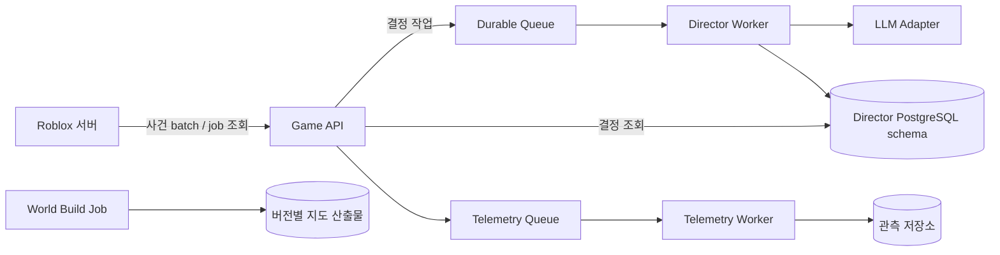

# MSA 시스템 구조 및 서비스 명세

작성일: 2026-10-08 · 계약 제안 v1 · 미구현

## 1. 논리 서비스와 물리 서비스

Roblox의 실시간 도메인을 매번 HTTP로 분리하지 않는다. 게임 서버 내부에는 명확한 소유권을 가진 모듈을 두고,
외부 MSA에는 독립 배포·확장할 이유가 있는 AI·관측·콘텐츠 기능을 둔다.
초기 외부 배포는 `game-api`, `director-worker`, `telemetry-worker`의 세 프로세스이며
트래픽이 작으면 API와 수집 처리를 한 배포에 묶을 수 있다. 논리 경계와 데이터 소유권은 유지한다.



## 2. Roblox 내부 서비스

| 서비스 | 소유 상태 | 입력/출력 | 장애·검증 |
|---|---|---|---|
| SessionService | 접속·역할·세션 잠금 | Join, SwitchRole, Leave | 프로필 로드 실패 시 새 기본값 덮어쓰기 금지 |
| VehicleService | 좌석·연료·손상·활성 차량 | Enter, DriveIntent, Exit | 소유권·정차·거리·물리 이상 검증 |
| DispatchService | 콜·예약·만료 | CreateCall, AcceptCall, Expire | 서버 직렬 전이/CAS 개념으로 한 기사만 확정 |
| RideService | 운송 상태·당사자·견적 | Board, Arrive, Cancel | 상태 버전·좌석·경로·위치 확인 |
| NavigationService | 도로 그래프·경로 캐시 | Route(origin,destination) | 끊긴 경로면 승차 전에 거절/대체 |
| CitizenService | 시민 목표·대화·관계 | Talk, RequestTaxi, React | 예약·탑승 시민 중복 생성 금지 |
| TrafficService | 차선 점유·신호·교통 목표 | Yield, Stop, Reroute | 교착 복구, 관심 영역 예산 |
| LawService | 위반 증거·벌금·벌점 | ReportIncident, IssuePenalty | 증거 ID별 중복 발급 방지 |
| PoliceService | 관측·수배·추격·수색 | Observe, Pursue, Search | 마지막 목격 지점만 사용 |
| LicenseService | 자격·교육 명령·기한 | CompleteLesson, Suspend | 광고와 무관한 완료·회복 |
| EconomyService | 잔액·예치·정산·상품 인벤토리 | Reserve, Settle, Refund, Grant | 서버 금액 계산, 거래 멱등성 |
| GarageService | 차량 목록·등급·꾸미기 | Buy, Equip, Repair, Wash | Economy 확인 후 반영, 추격 중 교체 금지 |
| DirectorBridge | 요청·결정·만료·예산 | Summarize, ApplyActions | 비동기·검증·회로 차단·규칙 대체 |

게임 서버 하나가 해당 월드의 배차를 소유한다. cross-server 콜 수락은 초기 제공하지 않는다.
MemoryStore는 미래 임시 매칭·presence용 후보일 뿐 잔액·운송 정산의 영속 저장소가 아니다.

## 3. 외부 서비스

| 서비스 | 역할 | 데이터 소유 | 실패 시 |
|---|---|---|---|
| Game API | 서버 인증, 스키마·크기 검증, 요청 제한, 작업 접수/조회 | 세션·중복 요청·작업 메타데이터 | Roblox 규칙 감독으로 전환 |
| Director Worker | 관측 요약→허용 행동 제안, 구조화된 NPC 기억 | 결정·모델/프롬프트 버전·만료 | 작업 실패/만료, 재시도 상한 |
| Model Adapter | 공급자 호출, 토큰·시간 제한, 출력 스키마 | 외부 모델 키 | 공급자 오류를 상위로 전달, 자의적 권한 확장 금지 |
| Telemetry Worker | batch 수집·지표 집계·오류 진단 | 비식별 운영 이벤트 | bounded buffer/drop 허용, 게임 진행 유지 |
| World Build Job | 좌표 변환·도로망·LOD 가공·권리 manifest | 지도 빌드 산출물 | 기존 승인 버전 유지 |
| Config 배포 기능 | 설정 버전·기능 flag·중지 스위치 | 불변 설정 버전 | 게임에 포함된 마지막 정상 설정 |

초기 하나의 관리형 PostgreSQL을 쓸 수 있지만 서비스별 schema·DB role로 쓰기 소유권을 분리한다.
다른 서비스 테이블을 직접 수정하지 않는다. 외부 DB에는 Roblox 지갑의 별도 권위 있는 복제본을 만들지 않는다.

작업 접수는 DB의 job·멱등키·outbox를 한 트랜잭션으로 기록한 뒤 202를 반환한다.
outbox 전달기가 큐에 발행하고 worker는 jobId로 중복 제거한다. 큐 성공과 DB 성공을 별개로 쓰는 유실 구간을 만들지 않는다.
worker의 처리 lease·재시도 횟수·deadline을 두고 한도를 넘기면 dead-letter로 이동한다.
Telemetry는 별도 큐가 접수를 확인한 뒤 응답하며, 양쪽 경로의 장애·재시도·중복을 하네스에서 확인한다.

## 4. 공통 이벤트 계약

```json
{
  "schemaVersion": "1.0",
  "eventId": "evt-unique",
  "type": "ride.completed",
  "environment": "staging",
  "serverSessionId": "session-unique",
  "worldRevision": 184,
  "aggregateId": "ride-unique",
  "sequence": 7,
  "occurredAt": "2026-10-08T06:00:00Z",
  "correlationId": "ride-unique",
  "payload": { "districtId": "test-a", "fareUnits": 120 }
}
```

시간은 UTC, UI는 사용자 시간대를 따른다. ID는 서버가 생성한다. 클라이언트가 보낸 식별자로 권한을 인정하지 않는다.
외부 전달은 at-least-once이며 eventId를 중복 제거한다. 전체 이벤트의 전역 순서를 가정하지 않는다.
aggregate별 sequence로 오래된 이벤트를 무시하고 빠진 이벤트는 스냅샷으로 보완한다.
AI·분석 이벤트는 비권위적이다. 금전 정확성을 이 큐 전달 성공 여부에 의존시키지 않는다.
이벤트 필드에 자유 채팅·실명·민감한 개인 정보를 넣지 않는다.

## 5. 제안 HTTP API

| API | 요청/응답 | 계약 |
|---|---|---|
| `POST /v1/server-sessions` | 빌드·환경·JobId → sessionId·짧은 세션 토큰 | 환경별 bootstrap 비밀로 인증, JobId만으로 신뢰 금지 |
| `POST /v1/events:batch` | 이벤트 목록 → 접수/중복 수 | 크기 제한·eventId 멱등성, 202는 영속 접수 뒤 반환 |
| `POST /v1/director/jobs` | 상태 요약·허용 action·deadline → jobId | Idempotency-Key, 202; 큐 내 작업 상한 |
| `GET /v1/director/jobs/{id}` | queued/running/completed/expired/failed | 다른 세션의 작업 조회 금지 |
| `GET /v1/config?version=...` | 환경에 허용된 설정 버전 | allowlist·캐시, 임의 코드 없음 |
| `GET /health/live` | 프로세스 생존 | 모델 가용성과 분리 |
| `GET /health/ready` | 요청 접수 가능 여부 | 필요한 큐·DB만 확인 |

제안 응답 코드: 400 스키마 오류, 401/403 인증·범위, 409 동일 키/상이 payload 또는 버전 충돌,
413 크기 초과, 429 예산·요청 제한, 503 접수 불가. 429/503만 지수 backoff+jitter로 제한 재시도한다.
4xx 입력 오류는 자동 무한 재시도하지 않는다. Roblox는 모델 응답 동안 주행 루프를 멈추지 않는다.
HTTP 응답이 없어도 작업이 접수됐을 수 있으므로 같은 멱등키로 재시도한다.
비밀은 Roblox Secrets와 외부 비밀 저장소에 두고 클라이언트로 복제하지 않는다.

## 6. AI 행동 계약

```json
{
  "schemaVersion": "1.0",
  "decisionId": "decision-unique",
  "serverSessionId": "session-unique",
  "basedOnRevision": 184,
  "expiresAt": "2026-10-08T06:00:20Z",
  "actions": [
    {
      "type": "REQUEST_PATROL",
      "districtId": "test-a",
      "incidentIds": ["incident-42"],
      "count": 1,
      "durationSeconds": 60
    }
  ]
}
```

허용 행동: `ADJUST_DEMAND`, `SET_NPC_GOAL`, `REQUEST_PATROL`, `OFFER_MISSION`, `SAY_LINE`.
각 action은 별도 schema와 대상/횟수/지속시간 범위를 가진다. `GRANT_MONEY`, `BAN_PLAYER`, `EXECUTE_CODE`는 없다.
SAY_LINE은 정책 검증 전 비활성이고 실패 시 준비된 대사로 대체한다.
미션 보상은 missionTemplateId에 고정되며 모델이 금액을 생성하지 못한다.
서버는 decisionId 중복, 세션, 만료, revision의 허용 차이, 사건/대상 상태, 쿨다운, 지역별 상한을 검증한다.
경찰 action은 LawService가 보유한 유효 incidentId가 필수다. 숨은 대상 좌표는 schema에 포함하지 않는다.
검증 실패는 reason code로 기록한다. 일부 독립 action만 허용할 수 있으며 각 적용 결과를 추적한다.
모델 입력의 대화는 명령이 아닌 데이터이며, 외부 URL 열기·도구 실행 권한을 부여하지 않는다.

## 7. 운송 상태와 불변식

`Requested → Reserved → EnRoutePickup → Boarding → InRide → Arrived → Settling → Completed`.
활성 상태에서 `CancelPending → Cancelled`, 장애 시 `RecoveryPending`으로 이동할 수 있다.
상태 전이는 expectedVersion과 서버 권한을 요구한다. 수락 검증부터 예약 확정 사이에는 yield하지 않는다.
각 플레이어는 한 번에 하나의 활성 운송/좌석만 가진다. 활성 승객이 있는 차량 교체는 거절한다.
종료된 운송을 재정산하지 않는다. 종료 이유에 따라 위약금·환불 규칙을 고정하며 AI가 정하지 않는다.

## 8. 영속 저장·금전 정산

프로필에는 schemaVersion, revision, lockOwner/lease, wallet, escrow, vehicles, license,
progression, pendingTransactions, bounded appliedTransactionIds를 보관한다.
UpdateAsync와 세션 잠금을 사용하고 갱신 콜백 안에 HTTP나 부수 효과를 넣지 않는다.
저장 실패 시 성공 UI를 확정하지 않는다. 새 금전 거래를 제한하고 재시도·복구 상태를 표시한다.
종료 시 저장만 믿지 않고 정상 운행 중 중요한 거래를 영속화한다.

NPC 운송은 기사 한 프로필에서 보상과 거래 ID를 같은 업데이트로 반영한다.
유저 간 정산은 두 프로필을 원자적으로 쓸 수 있다고 가정하지 않고 **복구 가능한 saga**로 처리한다.

1. 호출 시 손님 프로필에서 spendable을 줄이고 rideId별 escrow를 같은 업데이트로 확보한다.
2. 예치 확인 후 운송 저널을 활성화한다. 중단 시 고아 escrow를 다음 로드에서 저널과 대조해 복구한다.
3. 종료 시 rideId 저널을 `PREPARED`로 영속화한다. 요금·환불·기사 지급을 불변 값으로 고정한다.
4. 손님 프로필의 escrow를 같은 transactionId로 소비/환불하고 적용 표시를 남긴다.
5. 기사 프로필에 같은 transactionId로 지급한다. 다른 세션 잠금이 있으면 대기하며 강제로 쓰지 않는다.
6. 저널을 `COMMITTED`로 전이한다. 중간 실패는 기록된 상태부터 멱등 재개한다.

기사 지급 이후 저널 기록이 실패해도 적용 ID로 이중 지급을 막는다. 롤백이 필요한 종료도 별도 보상 거래 ID로 처리한다.
접속 종료로 해제되지 않은 프로필은 lease/fencing 검증 후 새 소유자가 복구한다.
활성 거래 ID는 제거하지 않는다. 완료 거래의 중복 제거 보존 기간과 저널 정리는 P4에서 부하·재시도 창을 정해 검증한다.
복구 worker는 접속·정기 실행·시작 시 pending 인덱스를 읽으며 인덱스 누락도 프로필 pending 목록과 대조한다.
이는 설계 계약이며, 모든 실패 지점 테스트를 통과하기 전 유저 간 돈 이동을 출시하지 않는다.

상품 지급도 플랫폼 영수증 ID로 영속 멱등성을 확보하고 저장 성공 전 구매 완료를 승인하지 않는다.
광고 보상은 플랫폼이 확인한 완료 경로만 사용하며 클라이언트의 시청 완료 메시지를 신뢰하지 않는다.

## 9. 버전·지연·관측

- 배포 동안 API/게임 계약은 현재와 직전 버전을 허용하는 expand/contract 방식을 사용한다.
- 작업별 deadline 초과 응답은 적용하지 않는다. stale decision은 버리고 다음 요약에 현재 상태를 보낸다.
- 세션별 AI 요청량·토큰·동시 작업 상한과 전체 비용 한도를 둔다. 초과 시 규칙 감독으로 전환한다.
- 최초 AI 주기 15–30초는 목표이며 외부 요청 제한과 측정 결과로 조정한다.
- 지표: 배차 충돌, 정산 중복 차단, pending 거래 나이, 저장 실패, AI p95 지연·거절률·비용, fallback 비율.
- trace에 buildId, configVersion, mapVersion, promptVersion, modelVersion, scenarioId를 연결한다.
- 서버가 죽으면 해당 월드의 AI 작업은 만료시킨다. 다른 월드로 재배달하지 않는다.

배포 설정은 [배포 구조](DEPLOYMENT.md), 실패 시나리오는 [하네스](HARNESS_ENGINEERING.md)를 따른다.
