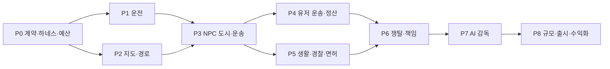

# 작업 정리 및 단계별 실행 계획

작성일: 2026-10-08 · DOC-001 문서 작성 완료 · 게임 구현 작업은 아래 상태 참조

## 1. 현재 상태와 우선순위

현재: Rojo 기본 프로젝트. 목표: 먼저 NPC 기반 단일 운송을 실제 엔진에서 완성한 뒤 유저 정산·생활·경쟁·AI를 추가한다.
수십 ㎢ 전체를 수작업으로 먼저 만들지 않고 데이터 가공·도로망·LOD의 반복 가능한 제작 과정을 검증한다.
외부 AI를 첫 구현의 필수 의존성으로 만들지 않는다.
상태 의미와 완료 gate는 [하네스 문서](HARNESS_ENGINEERING.md)를 따른다.

## 2. 의존 흐름

화살표는 선행 검증이며 병렬 에이전트 실행 지시가 아니다. 각 단계는 작은 작업 계약으로 나눠 진행한다.

## 3. 작업 목록

| ID | 단계/범위 | 선행 | 산출물·완료 조건 | 검증 | 상태 |
|---|---|---|---|---|---|
| DOC-001 | 이번 설계 문서 | 없음 | 기능·구조·MSA·배포·하네스·작업·근거 문서, 링크 검증 | 문서 QA | DONE |
| T001 | P0 기준선 | DOC-001 | synthetic city, 목표 기기·성능/비용 예산, toolchain 고정, build 실행 | G0/G1 | TODO |
| T002 | P0 계약·runner | T001 | ID·DTO·schema, FakeClock/Random, 시나리오 runner, 문서화된 실제 명령 | H03/H04 예제 | TODO |
| T003 | P0 저장 하네스 | T002 | FakeProfileStore, 잠금/쓰기/응답 유실 fault, profile 버전·복구 규칙 | H07/H08 | TODO |
| T004 | P0 로컬 외부 환경 | T002 | API·큐·worker·mock 모델·compose, 키 없는 오프라인 실행 | H17/H18 | TODO |
| T101 | P1 차량·입력 | T001 | 기본 택시, 도보/승하차, PC·모바일 조작, 좌석 소유 | H02/H22 | TODO |
| T102 | P1 카메라·HUD | T101 | 운전석/추적 카메라, 속도·연료·상태, 입력 기기별 UI | H02/G3 | TODO |
| T201 | P2 지도 권리·좌표 | T001 | 첫 지역 데이터 밀도 조사, 라이선스 manifest, 공통 좌표 변환 | 알려진 좌표 검증 | TODO |
| T202 | P2 도로·경로 | T201/T002 | 일방통행·층·회전·승하차 그래프와 재탐색 | H10 | TODO |
| T203 | P2 LOD·스트리밍 | T101/T201 | 구역 빌드, 상세도·전방 준비·안전 복구, map manifest | H09/H23 | TODO |
| T301 | P3 시민·대화 | T202 | 보행·횡단·대기·택시 제안·사건 반응 상태기계 | H12/H23 | TODO |
| T302 | P3 교통 | T101/T202 | 승용차·NPC 택시·버스, 차간 거리·신호·교착 복구 | H11 | TODO |
| T303 | P3 NPC 배차·운송 | T102/T202/T301/T003 | 콜·단일 예약·승하차·NPC 보상·저장 | H01/H03/H04 | TODO |
| T304 | P3 첫 종단 체험 | T203/T302/T303 | 혼자 3회 연속 NPC 운송, 지도·HUD·교통 통합 | H01/H09/G3 | TODO |
| T401 | P4 유저 호출·기사 선택 | T304 | 역할 전환, 견적·자동/선택 배차, 기사 부재 대체 | H03/H06 | TODO |
| T402 | P4 예치·정산 saga | T401/T003 | 영속 저널·예치·지급·환불·pending 복구, 중복 제거 보존 정책 | H04/H05/H07/H08 | TODO |
| T403 | P4 재접속·부정 방지 | T402 | 역할/좌석 복구, 원인별 취소, 공모·가짜 명령 방어 | H06/H16/H22/H25 | TODO |
| T501 | P5 차량 생활·성장 | T304 | 연료·세차·수리·차고·등급·기본 복구 | H15/경제 soak | TODO |
| T502 | P5 단속·면허·교육 | T501 | 서버 신호 판정·증거·벌금·교육·정지/회복 | H14/H15 | TODO |
| T503 | P5 경찰·추격 | T302/T502 | 순찰·신고·정차 명령·추격/수색·체포·지원 상한 | H13/H14 | TODO |
| T601 | P6 쟁탈·충돌 | T403/T503 | NPC 강탈·던지기·유기·플레이어 보호 | H12/H16 | TODO |
| T602 | P6 책임·보험·경제 | T601 | 가해/피해 판정·제한 보험·반복 공격 방지 | H16/H25 | TODO |
| T701 | P7 AI 관측·행동 계약 | T004/T602 | 요약·관측 제한·action schema·규칙 감독 baseline | H17/H18/H19 | TODO |
| T702 | P7 외부 감독 | T701 | 비동기 작업·예산·TTL·검증·circuit breaker, 실제 모델 adapter | H17/H18/G2 | TODO |
| T703 | P7 AI 평가·주요 NPC | T702 | 고정 eval 세트·기억 수명·대사 정책, baseline 비교 보고 | H13/H19/AI eval | TODO |
| T801 | P8 규모·운영 | T703 | 24명 목표·지도 확장 부하, staging/production infra·복구 드릴 | H09/H11/H24 | TODO |
| T802 | P8 구매·광고 | T402/T502 | 영수증 멱등 지급, 선택형 광고·적격성·무광고 경로 | H20/H21 | TODO |
| T803 | P8 출시 검증 | T801/T802 | 정책·권리·등급·기기·예산·릴리스 manifest·rollback | G4 | TODO |

기간 견적은 팀 규모·에셋 품질·목표 기기·실측 속도 확인 후 산정한다. 임의 출시일을 약속하지 않는다.
소유자는 착수 시 작업 계약에 기록한다. TODO를 실행 가능한 명령이 있는 READY로 바꾸려면 선행 조건이 충족돼야 한다.

## 4. 마일스톤 승인 증거

| 마일스톤 | 플레이 가능한 결과 | 진행 금지 조건 |
|---|---|---|
| M1 운전 | 걷다가 택시를 타고 주행·하차 | 조작 불안정·좌석 중복 |
| M2 혼자 하는 택시 | NPC와 대화하고 콜·픽업·운송·돈 벌기 | 중복 지급·경로 단절·스트리밍 추락 |
| M3 유저끼리 운송 | 손님 호출·기사 선택·정산·재접속 복구 | saga 실패 지점 미검증 |
| M4 살아 있는 도시 | 교통·관리비·경찰 추격·무료 교육 복귀 | 무한 교착·불공정 경찰·파산 막힘 |
| M5 콜 전쟁 | 쟁탈·던지기·사고·보험·피해 보호 | 피해자 자동 벌금·공모 수익 |
| M6 적응형 도시 | AI가 사건·수요를 조절하고 장애 시 계속 플레이 | AI 금전 권한·무제한 비용·지연 멈춤 |
| M7 출시 후보 | 성능·권리·광고·구매·운영 복구 확인 | NOT_RUN 핵심 검증 또는 정책 불명 |

## 5. 당장 착수할 작업 계약: T001

- 목표: 다른 개발자/에이전트가 같은 환경에서 기본 place를 빌드하고 시험할 수 있는 기준선.
- 변경 범위: taximulation 도구 설정·테스트용 synthetic city·harness 뼈대·README 명령.
- 입력: 현재 Rojo 7.7.1 프로젝트와 이번 설계 문서.
- 산출물: 검증된 도구 버전, 최소 도로·교차로·승하차 구역, client/server 타이밍 수집, 기기 목록·예산 초안.
- 제외: 서울 실제 데이터 대량 가공, 외부 유료 배포, AI 실모델, 수익화.
- 검증: Rojo 빌드와 Studio 실행, 빈 도시에서 메모리·frame/server time 기준 측정.
- 완료 증거: 명령·버전·commit·Studio 절차·측정 결과. Studio 실행 불가면 명시하고 M1 완료로 간주하지 않는다.

## 6. 위험과 선행 조사

| 위험 | 해소 작업 |
|---|---|
| 특정 서울 구역의 OSM 누락·고도/건물 정보 부족 | T201 샘플을 먼저 검사하고 보완 비용 기록 |
| 지도 권리와 외부 호스팅/재배포 조건 불명 | T201 권리 manifest, 불명 자산은 빌드 제외 |
| 높은 교통량·큰 좌표·모바일 물리 비용 | T203/T302/T801 프로파일, 밀도·시뮬레이션 범위 조정 |
| 두 프로필 정산 crash·중복 | T402 각 영속 단계 fault 검증 |
| 플레이어 괴롭힘·경제 공모 | T601/T602 보호·귀책·보상 상한 |
| 모델 지연·비용·정책 | T701–T703 baseline·하드 예산·검증·콘텐츠 검토 |
| 광고 요건 미충족 | T802 선택형만 구현, 자격 충족 전 비활성 |

## 7. 이번 작업 완료 기록

DOC-001은 문서 산출 작업이다. 이번 작업에서 실행 코드·지도 에셋·서비스·CI·배포·하네스 runner는 구현하지 않았다.
따라서 기능 시나리오 H01–H25의 상태는 모두 NOT_RUN이다. 실제 후속 작업 때 결과와 증거 링크를 갱신한다.
